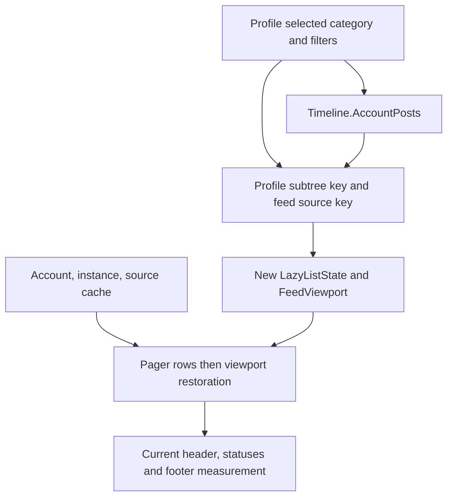

### Overview

The requested outcome is a Profile whose visible header and tabs stay steady when changing categories, and Settings children with one title and one standard back action. At baseline `df7c305`, Profile already has unified vertical reading within each category. The remaining state boundary is between categories. Each category recreates its feed viewport and restores that source’s cached position. About has another list entirely.

Settings has a different split. AppShell owns route title and route back, while SettingsScreen privately owns its subsection and renders another back control. AppShell cannot see the subsection. This is source analysis only. Root owns native reproduction. The Fix Root Causes principle shaped the trace by separating viewport replacement, cache restoration, and content-height constraints instead of assuming every movement has one cause.

### Key Concepts

- `ProfileScreen` owns the person, relationship, selected category, Activity filters, and action dialogs. Its `leadingContent` contains the full header, action controls, profile text, category tabs, and optional Activity filters. [Accounts.kt:163](/Users/bobmaster/Projects/QuanToot_Next/shared/src/commonMain/kotlin/com/quanquan/quantoot/ui/Accounts.kt:163).
- `FeedScreen` owns a source-keyed `LazyListState` and `FeedViewport`. `rememberFeedPager` owns the lifetime of that source’s cache restoration and `FeedPager`. [Feeds.kt:192](/Users/bobmaster/Projects/QuanToot_Next/shared/src/commonMain/kotlin/com/quanquan/quantoot/ui/Feeds.kt:192).
- `FeedPosition` distinguishes a leading-item pixel offset from a status index and offset. `FeedSnapshot.items/index/offset` remain status coordinates. `leadingOffset` is separate metadata. [FeedPosition.kt:3](/Users/bobmaster/Projects/QuanToot_Next/shared/src/commonMain/kotlin/com/quanquan/quantoot/ui/FeedPosition.kt:3), [FeedCache.kt:13](/Users/bobmaster/Projects/QuanToot_Next/shared/src/commonMain/kotlin/com/quanquan/quantoot/ui/FeedCache.kt:13).
- AppShell owns `routes`, root tab selection, and the retained Home source. `Screen.Settings` carries no subsection. SettingsScreen’s nullable string is the only subsection state today. [QuanTootApp.kt:114](/Users/bobmaster/Projects/QuanToot_Next/shared/src/commonMain/kotlin/com/quanquan/quantoot/QuanTootApp.kt:114), [Foundation.kt:53](/Users/bobmaster/Projects/QuanToot_Next/shared/src/commonMain/kotlin/com/quanquan/quantoot/ui/Foundation.kt:53), [Settings.kt:22](/Users/bobmaster/Projects/QuanToot_Next/shared/src/commonMain/kotlin/com/quanquan/quantoot/ui/Settings.kt:22).

### How It Works

Clicking a Profile category changes `selected`. For Posts, Media, Featured, and Activity, the outer `key(id, selected, showReplies, showBoosts)` then replaces its `FeedScreen` subtree. The category and filters also produce a `Timeline.AccountPosts` value. FeedScreen keys its own subtree by API, active account, and `source.toString()`, so changing the actual source independently replaces its list state. Even if two category/filter combinations produce the same source, the outer `selected` key still replaces the subtree. [Accounts.kt:320](/Users/bobmaster/Projects/QuanToot_Next/shared/src/commonMain/kotlin/com/quanquan/quantoot/ui/Accounts.kt:320), [Accounts.kt:368](/Users/bobmaster/Projects/QuanToot_Next/shared/src/commonMain/kotlin/com/quanquan/quantoot/ui/Accounts.kt:368), [Feeds.kt:198](/Users/bobmaster/Projects/QuanToot_Next/shared/src/commonMain/kotlin/com/quanquan/quantoot/ui/Feeds.kt:198).

The header’s stable `feed:leading` key identifies its row inside a given feed list. It does not retain a shared viewport across newly created lists. About bypasses FeedScreen and creates a separate `LazyColumn`, using `profile:leading` and its own implicit list state. Moving to or from About therefore crosses another list lifetime. Activity also adds a filter row inside the leading item, changing that item’s height. [Feeds.kt:251](/Users/bobmaster/Projects/QuanToot_Next/shared/src/commonMain/kotlin/com/quanquan/quantoot/ui/Feeds.kt:251), [Accounts.kt:325](/Users/bobmaster/Projects/QuanToot_Next/shared/src/commonMain/kotlin/com/quanquan/quantoot/ui/Accounts.kt:325), [Accounts.kt:343](/Users/bobmaster/Projects/QuanToot_Next/shared/src/commonMain/kotlin/com/quanquan/quantoot/ui/Accounts.kt:343).

Each new pager reads its cache, projects restored rows, restores the viewport, and only then enables persistence and normal loading. A leading restoration first scrolls to row zero, waits until `feed:leading` has a measured size, clamps the saved offset to that item’s height minus one, then requests the offset. Persistence waits 400 ms after a snapshot and has no disposal flush in this function. A fast switch can therefore discard a pending write and later restore an older saved position. The source proves that possibility, but native evidence must determine whether it explains this particular jump. [Feeds.kt:115](/Users/bobmaster/Projects/QuanToot_Next/shared/src/commonMain/kotlin/com/quanquan/quantoot/ui/Feeds.kt:115), [Feeds.kt:153](/Users/bobmaster/Projects/QuanToot_Next/shared/src/commonMain/kotlin/com/quanquan/quantoot/ui/Feeds.kt:153).

Empty and short categories need separate treatment. The header-height clamp establishes that an offset lies inside the leading row. It does not establish that the whole list has enough content below it to attain that offset. FeedScreen’s trailing content changes between loading, empty, populated, and exhausted states. It always has bottom padding, but it provides no minimum body extent. About likewise provides no minimum trailing extent. Layout clamping when content becomes shorter is therefore a distinct mechanism to check on the native surface. The existing helper test covers changed header height and empty cached rows; it does not measure actual LazyColumn maximum scroll. [FeedPosition.kt:42](/Users/bobmaster/Projects/QuanToot_Next/shared/src/commonMain/kotlin/com/quanquan/quantoot/ui/FeedPosition.kt:42), [Feeds.kt:254](/Users/bobmaster/Projects/QuanToot_Next/shared/src/commonMain/kotlin/com/quanquan/quantoot/ui/Feeds.kt:254), [FeedPositionTest.kt:38](/Users/bobmaster/Projects/QuanToot_Next/shared/src/commonTest/kotlin/com/quanquan/quantoot/ui/FeedPositionTest.kt:38).

For Settings, choosing a row changes the private `section` string without pushing a route. The same SettingsScreen retains its scroll owner, then `LaunchedEffect(section)` scrolls it to zero. A child displays `‹ Settings`, whose handler sets `section = null`. AppShell still sees only `Screen.Settings`, so its title remains Settings and its arrow calls `ui.requestBack()`. The shell’s platform BackHandler calls the same method. Settings does not install `beforeBack`; consequently those standard back actions pop the Settings route rather than returning to its local menu. [Settings.kt:23](/Users/bobmaster/Projects/QuanToot_Next/shared/src/commonMain/kotlin/com/quanquan/quantoot/ui/Settings.kt:23), [QuanTootApp.kt:157](/Users/bobmaster/Projects/QuanToot_Next/shared/src/commonMain/kotlin/com/quanquan/quantoot/QuanTootApp.kt:157), [QuanTootApp.kt:194](/Users/bobmaster/Projects/QuanToot_Next/shared/src/commonMain/kotlin/com/quanquan/quantoot/QuanTootApp.kt:194), [Foundation.kt:75](/Users/bobmaster/Projects/QuanToot_Next/shared/src/commonMain/kotlin/com/quanquan/quantoot/ui/Foundation.kt:75).

Child headings are not uniform today. Licenses adds a `titleLarge` heading. Privacy Policy adds “QuanToot Privacy Policy” as `headlineSmall`. Server information renders the server’s own title and its About, Rules, Contact tabs. Account privacy, posting defaults, filters, and notification policy do not add a general page title. The duplicated Settings wording visible across all children comes from the shell title plus the local back label, rather than every child adding another Settings heading. Navigating away disposes SettingsScreen because AppShell keys its current screen by the route. Returning constructs the local `section` at null. [Settings.kt:94](/Users/bobmaster/Projects/QuanToot_Next/shared/src/commonMain/kotlin/com/quanquan/quantoot/ui/Settings.kt:94), [Settings.kt:452](/Users/bobmaster/Projects/QuanToot_Next/shared/src/commonMain/kotlin/com/quanquan/quantoot/ui/Settings.kt:452), [ServerInformation.kt:47](/Users/bobmaster/Projects/QuanToot_Next/shared/src/commonMain/kotlin/com/quanquan/quantoot/ui/ServerInformation.kt:47), [QuanTootApp.kt:267](/Users/bobmaster/Projects/QuanToot_Next/shared/src/commonMain/kotlin/com/quanquan/quantoot/QuanTootApp.kt:267).

### Where Things Live

- [Accounts.kt:163](/Users/bobmaster/Projects/QuanToot_Next/shared/src/commonMain/kotlin/com/quanquan/quantoot/ui/Accounts.kt:163) contains Profile selection, leading content, About, and action handlers.
- [Feeds.kt:95](/Users/bobmaster/Projects/QuanToot_Next/shared/src/commonMain/kotlin/com/quanquan/quantoot/ui/Feeds.kt:95) contains mixed-list viewport translation, restoration, feed composition, and refresh lifecycle.
- [FeedPosition.kt:26](/Users/bobmaster/Projects/QuanToot_Next/shared/src/commonMain/kotlin/com/quanquan/quantoot/ui/FeedPosition.kt:26) and [FeedCache.kt:92](/Users/bobmaster/Projects/QuanToot_Next/shared/src/commonMain/kotlin/com/quanquan/quantoot/ui/FeedCache.kt:92) contain position recovery and pager state.
- [Settings.kt:22](/Users/bobmaster/Projects/QuanToot_Next/shared/src/commonMain/kotlin/com/quanquan/quantoot/ui/Settings.kt:22), [Foundation.kt:38](/Users/bobmaster/Projects/QuanToot_Next/shared/src/commonMain/kotlin/com/quanquan/quantoot/ui/Foundation.kt:38), and [QuanTootApp.kt:108](/Users/bobmaster/Projects/QuanToot_Next/shared/src/commonMain/kotlin/com/quanquan/quantoot/QuanTootApp.kt:108) define the current local-section and route ownership split.

### Gotchas

The following existing invariants constrain the correction.

- Header pixels must never become status pixels. Legacy snapshots remain status coordinates. Restoration follows status identity after projection, falls to a surviving neighbor with zero offset, and uses the leading item only when no status survives. Cache truncation resets invalid status pixels while preserving separate leading metadata. [FeedPosition.kt:21](/Users/bobmaster/Projects/QuanToot_Next/shared/src/commonMain/kotlin/com/quanquan/quantoot/ui/FeedPosition.kt:21), [FeedCache.kt:62](/Users/bobmaster/Projects/QuanToot_Next/shared/src/commonMain/kotlin/com/quanquan/quantoot/ui/FeedCache.kt:62).
- FeedPager owns rows, pending arrivals, continuation cursor, generation cancellation, and pagination readiness. `StatusProjection` remains the shared freshness and deletion owner. Profile category flags remain API query semantics. [FeedCache.kt:92](/Users/bobmaster/Projects/QuanToot_Next/shared/src/commonMain/kotlin/com/quanquan/quantoot/ui/FeedCache.kt:92), [StatusProjection.kt:27](/Users/bobmaster/Projects/QuanToot_Next/shared/src/commonMain/kotlin/com/quanquan/quantoot/ui/StatusProjection.kt:27), [MastodonApi.kt:244](/Users/bobmaster/Projects/QuanToot_Next/shared/src/commonMain/kotlin/com/quanquan/quantoot/data/MastodonApi.kt:244).
- Cache identity separates instance, active account, and source including filters. The outer application lifetime also resets on account, instance, or authorization revision changes. [FeedCache.kt:22](/Users/bobmaster/Projects/QuanToot_Next/shared/src/commonMain/kotlin/com/quanquan/quantoot/ui/FeedCache.kt:22), [QuanTootApp.kt:53](/Users/bobmaster/Projects/QuanToot_Next/shared/src/commonMain/kotlin/com/quanquan/quantoot/QuanTootApp.kt:53).
- The earlier accepted reading behavior is one scrolling area for Profile header, tabs, and posts, with no independently scrolling capped header. Nonsticky tabs were deliberate. That contract also preserved status-relative deferral, reveal-to-first-status, and status/footer pagination. [Accepted interaction design:5](/Users/bobmaster/Projects/QuanToot_Next/.audit/client-interactions/design.md:5).
- Home source selection already lives outside the route/tab rendering key in AppShell, within the account lifetime. Home, Local, and Federated retain their mappings and guest Local default. Returning from a child or switching root tabs must retain that selection without retaining hidden active feeds. [QuanTootApp.kt:115](/Users/bobmaster/Projects/QuanToot_Next/shared/src/commonMain/kotlin/com/quanquan/quantoot/QuanTootApp.kt:115), [Feeds.kt:29](/Users/bobmaster/Projects/QuanToot_Next/shared/src/commonMain/kotlin/com/quanquan/quantoot/ui/Feeds.kt:29).
